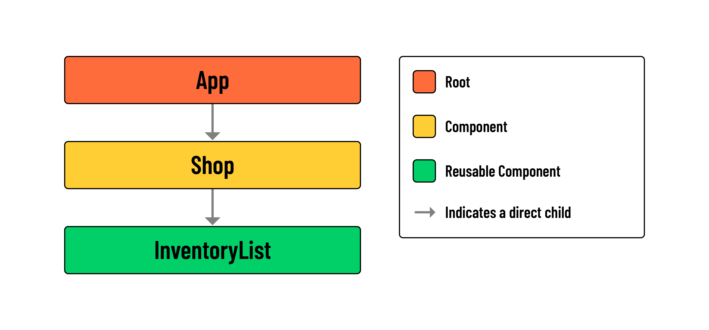

<h1>
  <span class="headline">Lifting State with Arrays in React Shopping Cart</span>
  <span class="subhead">Adding State to the <code>Shop</code> Component</span>
</h1>

**Learning objective:** By the end of this lesson, students will be able to import data and use it as the initial value of a state variable.

## A refresher on state

We are about to introduce state to our application, so let's take some time to review the concept.

### State in general

**State** is data or information an application or component needs to implement its functionality. State can only be passed **down** the component hierarchy, not up.

Examples of state include:

- An object representing the logged-in user.
- An array of todo objects.
- A boolean representing whether a component's detail panel should be visible.
- A number representing the selected or current index of an item in an array.

### The difference between state and props summarized

Let's summarize the key differences between state and props:

#### State

- State holds information owned by that component.
- State can be modified with hooks.
- When changed, it causes a component and all of its children and their children to re-render.

#### Props

- Props hold the information passed down the component hierarchy.
- Props cannot be modified.
- Since props cannot be changed, methods can be passed through props that will update state on the component that owns the state.

## State in our app

In our app, we will need state for remembering the following:

- items available in the shop (the shop's inventory).
- items in a user's inventory (their cart).

Where are we going to store our state?

If evaluating an application's state and data structures seems complicated, that's okay - it takes a bit of experience. Soon enough, you'll be able to recognize scenarios that you've seen before and apply those previous data structures and patterns.

### Initializing state

Let's begin by importing `useState` in `Shop.jsx`.

```jsx
// src/components/Shop/Shop.jsx

// npm modules
import { useState } from 'react';
```

Next, we'll want to make a few updates to `Shop.jsx`.

Create a new `useState()` variable called `inventory` and set the initial state to `inventoryData`. Then, we'll pass the `inventory` state down as props to the `InventoryList`.

The component should look like this when we are done:

```jsx
// src/components/Shop/Shop.jsx

// npm modules
import { useState } from 'react';

// components
import InventoryList from '../../components/InventoryList/InventoryList';

// data
import { inventoryData } from '../../data/data';

const Shop = () => {
  // Create state variable and pass new inventory state
  // to the InventoryList component below
  const [inventory, setInventory] = useState(inventoryData);

  return (
    <main>
      <h1>Shop</h1>
      <InventoryList inventory={inventory} />
    </main>
  );
};

export default Shop;
```

Check your browser. You'll see the same list of inventory items as before, but the source of this data is now a `useState()` variable called `inventory`, as opposed to the hardcoded `inventoryData` we were rendering earlier!

Here is the component hierarchy diagram for our work so far:


