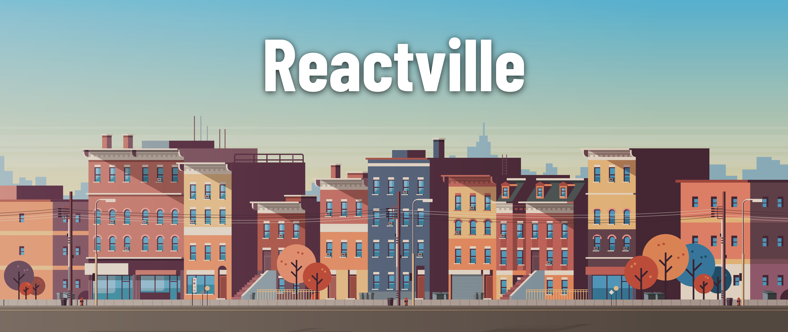
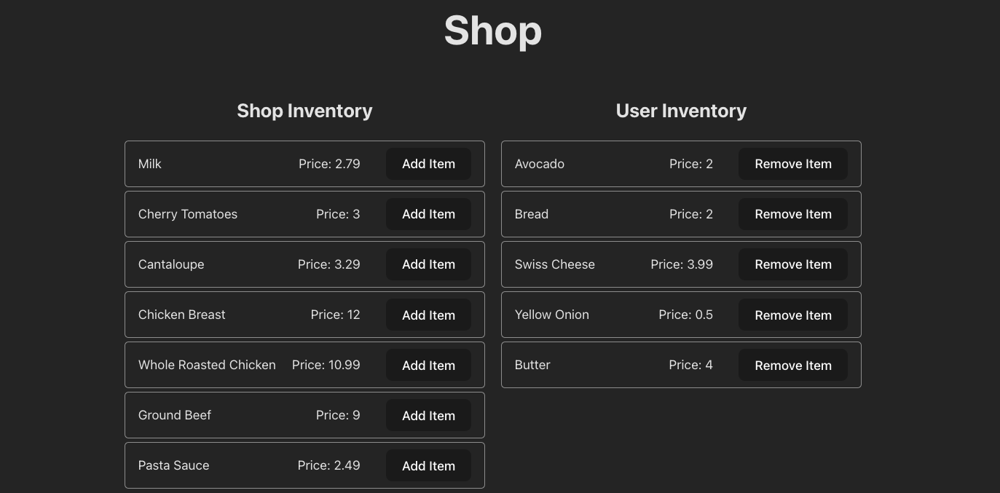

<h1>
  
  Lifting State with Arrays in React Shopping Cart
</h1>

## About

Welcome to Reactville, a constantly evolving virtual metropolis. Let's build this digital town together, one component at a time.

The local supermarket is implementing a new online ordering system and needs help building the user interface for a virtual shopping cart. Shoppers will be able to visually move items back and forth between the store shelves and their shopping carts.

In this module, students will explore advanced React techniques for managing more complex data structures like arrays in state. They'll gain practical experience by building a shopping cart application that responds to user actions. The key feature of this module is using event-driven programming to transfer items between two state arrays — representing the shop's inventory and the user's cart.

By the end of this module, students will have created a functional, interactive shopping cart using a reusable inventory component that visually represents both the store's and the user's inventory.

## Content

| Lesson                                                                                    | Skills                                                      |
| ----------------------------------------------------------------------------------------- | ----------------------------------------------------------- |
| [Setup](../setup/README.md)                                                               | Setting up the development environment.                     |
| [Component Hierarchy and Layout](../component-hierarchy-and-layout/README.md)             | Planning out a component hierarchy for a React App.         |
| [Building the `Shop` Component](../building-the-shop-component/README.md)                 | Creating a React component and mapping over data.           |
| [Passing Props](../passing-props/README.md)                                               | Passing props from a parent component to a child component. |
| [Adding State to the `Shop` Component](../adding-state-to-the-shop-component/README.md)   | Putting data into state.                                    |
| [Handling Click Events](../handling-click-events/README.md)                               | Impacting state with click event handlers.                  |
| [Reusing the `InventoryList` Component](../reusing-the-inventorylist-component/README.md) | Working with reusable components in React.                  |
| [Updating Arrays in State](../updating-arrays-in-state/README.md)                         | Moving objects between two arrays held in state.            |

## Level Up content

| Lesson                                          | Skills                               |
| ----------------------------------------------- | ------------------------------------ |
| [UI Improvements](../ui-improvements/README.md) | Reflecting an empty array in the UI. |

## References

📖 [Reference Materials](../references/README.md)
