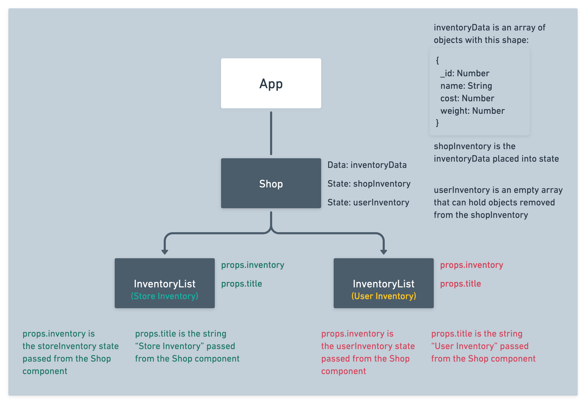

# 

**Learning objective:** By the end of this lesson, students will be able to tktk

## Reusable Component

Reusable components are a major strength of React. A reusable component is a piece of UI that can be reused in various parts of an application. They allow us to create multiple instances of the same UI shell, with the displayed data being determined by `props`. There isn’t any special syntax involved in making a component reusable, but they do require a bit of planning.

### Making Components Reusable

We’ll be making our `InventoryList` component reusable in the following steps.

At the moment, the `InventoryList` component displays an `h2` tag reading **Inventory List** alongside a list of items. With a few changes, the `InventoryList` component can be used to display items in the shop’s inventory, as well as items in the user’s inventory.

For this to work, we’ll need to add **two state variables** in `**src/components/Shop/Shop.jsx**`.

- `**shopInventory`**
    
    An array containing the available items in the shop. We’ll set its initial state to the imported `inventoryData`, as the shop should start out with all items available.
    
- `**userInventory**`
    
    An array containing items that have been added to the user’s inventory. We’ll set its initial state to an empty array.

> You can remove the existing inventory useState variable. We won’t need it anymore.

After this change and a few pieces changes we make to props, this will be our new component hierarchy diagram:



From `**src/components/Shop/Shop.jsx**`, we can pass each piece of state down to two separate instances of the `InventoryList`. The `InventoryList` component is already designed to map through the `inventory` prop data it receives. All we need to do is update the value associated with this prop for our multiple instances of `InventoryList` to work. We can also provide each `InventoryList` instance with a distinct `title` prop.

Time to make the adjustments. Let’s refactor `Shop.jsx` with the following.

```jsx
// src/components/Shop/Shop.jsx

// npm modules
import { useState } from "react"

// components
import InventoryList from "../../components/InventoryList/InventoryList"

// data
import { inventoryData } from "../../data/data"

const Shop = () => {
  // Create state variables for the shop and user inventories.
  const [shopInventory, setShopInventory] = useState(inventoryData)
  const [userInventory, setUserInventory] = useState([])

  const handleAddItem = () => {
    // We'll refactor this in a bit
  }

  return (
    <main>
      <h1>Shop</h1>
      <section>
        <InventoryList title="Shop Inventory" inventory={shopInventory} />
        <InventoryList title="User Inventory" inventory={userInventory} />
      </section>
    </main>
  )
}

export default Shop
```

Head back to `InventoryList.jsx`. We need to update the `h2` tag to make use of the `title` prop. 

```jsx
// src/components/InventoryList/InventoryList.jsx

const InventoryList = (props) => {
  return (
    <div>
      <h2>{props.title}</h2> 
      <ul>
        {props.inventory.map((item) => (
          <li key={item._id}>
            <p>{item.name}</p>
						<p>Cost: {item.cost}</p>
          </li>
        ))}
      </ul>
    </div>
  )
}

export default InventoryList
```

Check your browser! You should see two lists. One for the shop’s inventory, and another for the user’s inventory. At the moment, only the shop’s inventory will include items. The two lists are currently stacked on top of one another, so you’ll need to scroll to the bottom of the page to see the user’s inventory. 

